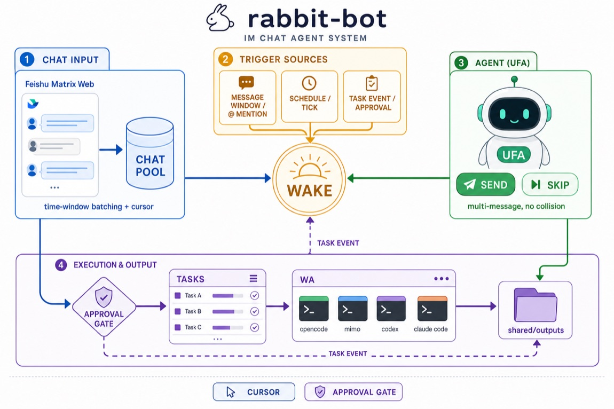

<div align="center">


<h1>rabbit-bot</h1>

<p><strong>告别机械的「一问一答」——拥有真实感对话体验、能一边聊天一边干重活的 IM Agent。</strong></p>

<p>接上飞书或 Matrix，用户的消息不再直接捅给大模型做回合制问答：<br>
多来源消息先进 <b>SQLite 聊天池</b>，经<b>读消息窗口（私聊优先）</b>汇成批次唤醒；<br>
前台的 <b>UFA</b> 在同一个上下文里一次看尽所有私聊与群聊，自由选择回复 <b>0 到多个来源</b>；<br>
后台的 <b>WA</b> 在独立进程里埋头跑代码、交产物，长任务跑多久都不污染前台的活人感。</p>

<p>
  <a href="https://nodejs.org"></a>
  <a href="https://www.typescriptlang.org"></a>
  <a href="https://sqlite.org"></a>
  <a href="https://pi.dev"></a>
  
  <a href="LICENSE"></a>
</p>

</div>

---

## 为什么所有 Bot 聊起来都像机器？

不管换上多聪明的模型，传统 IM Bot 用起来依然像个客服，根源在于两个底层死结：

1. **被焊死的「一问一答」回合制。**  
   真人说话从来不是乒乓球式的「你一拍、我一拍」——你会把一句话拆成三半连着发，会在不同群里同时抛话头，也会手滑打错字或者说句「算了不用回」。可传统 Bot 的代码是 `1 条消息 → 1 次触发 → 1 条必回` 的单行道，你按一次回车它就必须接一招，甚至冲出来回你一句*「好的！我将保持安静！」*。
2. **聊天和干活挤在同一个脑子里。**  
   一旦让它改代码、跑长任务，几十屏报错和终端日志瞬间塞爆当前会话。任务没跑完之前，你跟它说句闲话它都接不上，原本鲜活的人设直接退化成报错机器。

**rabbit-bot 做了一次彻底的人机对话交互革新。**

---

## 革新一：从「一问一答」到「多源合批，一屏尽览」（真实感对话体验）

在 rabbit-bot 里，用户的消息**不直接发给 Agent**。



1. **多来源进池 + 读消息窗口合批（私聊优先）**  
   飞书、Matrix 的私聊与群聊消息先落进各自的 **SQLite 聊天池（Pool）**。调度器的**读消息窗口**会把你连发的碎话自动攒齐，将私聊与群聊动静汇总成批次唤醒（私聊享有更高优先级）。
2. **同一个上下文批量看全局，选择性回 0 ~ N 个来源**  
   Agent（UFA）醒来时，是在**同一个上下文**里同时看到多个池子的未读批次——就像真人拿起手机一眼扫过所有红点：
   - 看到你在私聊连发三条，它可以一口气回你两句短话，再顺手帮你派个活；
   - 同时瞄见隔壁运维群有人贴了报错，它顺手往那个群里递一句解答；
   - 扫过另一个正在闲扯的群，觉得没自己什么事，直接按下 `skip` 略过（回复 **0** 个来源）。

| 传统 IM Bot（机械一问一答） | rabbit-bot（多源批次交互） |
|---|---|
| 用户每发 1 条消息，直接触发 1 次 LLM 并强制回复 1 条 | 消息先进 SQLite 聊天池，经**读消息窗口（私聊优先）**合批唤醒 |
| 各个会话彼此割裂，只会机械接球 | **同一上下文批量审视多个来源**，自主选择回复 **0 到多个池子** |
| 连发三句碎话会被它拆开回三段客服腔 | 等你把话说完一起看，可以回一句、连发三条、或者安静 `skip` |
| 聊天与长任务共用上下文，一跑活就失联 | **UFA 管真实对话 + WA 独立进程干活**，两边互不污染 |

---

## 革新二：一边埋头干重活，一边像活人一样聊天（UFA / WA 双层分身）

真正的分水岭，是把**「陪你的人」**和**「干活的手」**彻底拆成两层：

- **UFA（User-Facing Agent，前台对话人格）**：住在聊天框里的那个人。有人设、有脾气、记得住你们以前的事，在统一的上下文里统筹所有聊天池，只负责陪你说话、拿主意、派任务，**绝不亲自下场碰重活**。
- **WA（Working Agent，后台独立执行器）**：按任务拉起的独立进程（`opencode` / `mimo` / `codex` / `claude`）。没人设、不寒暄，给它目标和工作目录就埋头苦干，进度与产物经由任务面板和 `shared/` 回流给 UFA。

**两边不共享上下文，也不在同一个进程里。**  
后台 WA 哪怕正在跑三个小时的重构和压测，前台 UFA 的上下文依然轻盈干净，随时秒接你的下一句玩笑。

---

## 革新三：用确定性死代码，托住模型的活灵魂

这份像活人一样的松弛感，不是靠在提示词里写八百条「请你千万听话」求出来的。所有关乎秩序、记忆与安全的边界，全用普通 TypeScript 代码焊死在底座里：

| 确定性底座 | 它解决什么问题 |
|---|---|
| **多池 SQLite + 精确游标** | 每个聊天池独立维护已读游标 `#seq`；连发合批，哪怕进程中途重启也能严丝合缝接着读，绝不丢事件 |
| **读消息窗口与优先级调度** | 私聊与群聊按窗口汇总成批次唤醒，私聊优先响应；活跃期自动缩短 tick，安静期休眠零消耗 |
| **带有效期的长期记忆** | 按需检索，写明从何时成立、顶掉哪条旧记忆（`supersede`），过期自动失效，跨会话不靠模型硬背 |
| **越权审批门（Approval）** | 执行器要动宿主机敏感目录或执行高危命令，必须发进主聊天框等主人点头，超时直接按拒绝处理 |
| **三道预算硬顶** | 日调用次数、Token 消耗、每日花费三道硬闸门，撞线即停 |

Anthropic 近期在《Building always-on agents》里把常驻系统归纳为 Inbox / Timer / Memory / Permissions / Outbox 五件套（[解读](https://x.com/shao__meng/status/2121427594260398327)），与我们这套底座设计不谋而合。

---

## 30 秒先跑个 demo

demo 用内置的 mock 适配器 + 桩 LLM，不连真实 IM，也不消耗 API Key：

```bash
cd app
npm install
npm run demo
```

会走完一整套管线：**多源入池 → 读窗口合批 → 批次唤醒 → 选择性回复 0~N 个池子 → 派发 WA 后台任务 → 审计日志**。

## 接真实使用

正式跑要先在 `app/config/local.json` 里配模型服务商和模型：

```json
{
  "llm": { "provider": "deepseek", "model": "deepseek-flash" }
}
```

`provider/model` 得在 pi 的模型目录里（`npm run ctl -- models` 可查）。然后在 `~/.config/rabbit-bot/env` 里配这家服务商的 key 和 IM 凭据：

```bash
DEEPSEEK_API_KEY=...      # provider 用 openrouter 时改 OPENROUTER_API_KEY
FEISHU_APP_ID=...
FEISHU_APP_SECRET=...
```

部署、管理和执行器配置详见 [app/README.md](app/README.md)。

---

## 适合谁

- 受够了「每敲一次回车就被客服腔秒回一段」的机械问答，想要**真人般自然对话体验**的人
- 既要 Agent 能在多个私聊和群聊间游刃有余，又要它真能拉起终端改代码、跑脚本、交报告
- 愿意自己部署在本地或私有机器上，把记忆、密钥和审批权攥在自己手里

*不适合：高并发对外客服、实时语音对讲、开箱即用的多租户 SaaS。*

## 技术底座

Node ≥ 22.19 · TypeScript · SQLite · [pi](https://pi.dev) · React 管理台

调度、读窗口、游标、预算、审批门、防死循环、上下文满自动交接，全部是确定性代码；LLM 只在真正需要思考和表达时出场。

## 文档导航

| 文档 | 内容 |
|---|---|
| [需求文档.md](需求文档.md) | 产品边界与最初的设计依据 |
| [app/README.md](app/README.md) | 部署、配置、React 管理台、UFA/WA 任务模型 |
| [docs/agent-environment.md](docs/agent-environment.md) | **多环境部署**：macOS / Linux / Windows WSL2、Docker、常见踩坑 |
| [skills/rabbit-bot/deploy/](skills/rabbit-bot/deploy/SKILL.md) | **Agent 闭环部署**：分层流程、一句话复制指令、确定性排障决策树 |
| [docs/](docs/) | 架构、记忆、主动开口、沙盒、业务地图设计细节 |
| [docs/TROUBLESHOOT-executor-and-approval.md](docs/TROUBLESHOOT-executor-and-approval.md) | **踩坑手册**：执行器秒退、审批不发、session_id 空 |
| [skills/rabbit-bot/](skills/rabbit-bot/) | UFA / WA 工作手册 |
| [CLI.md](CLI.md) | 运维与查询命令速查 |

---

如果这个项目对你有启发，欢迎 Star、提 Issue，或者直接 fork 领养一只你自己的。
